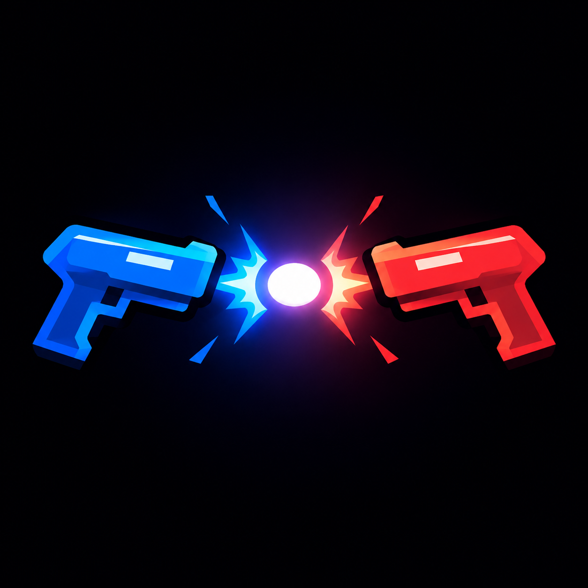
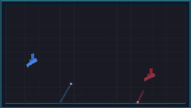
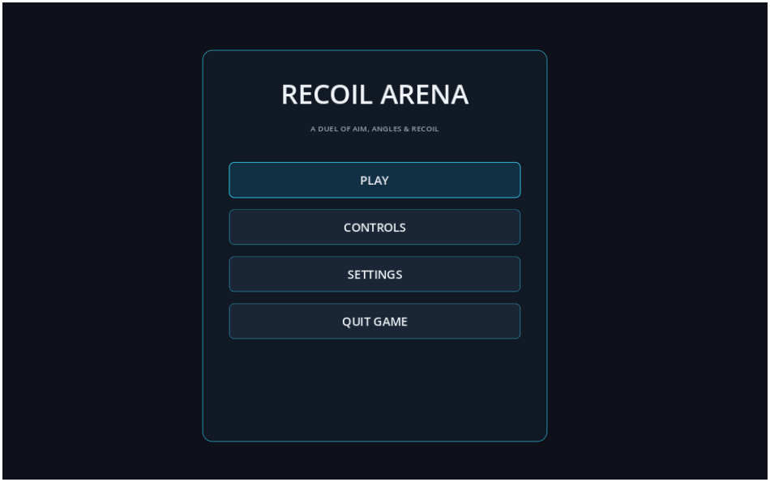
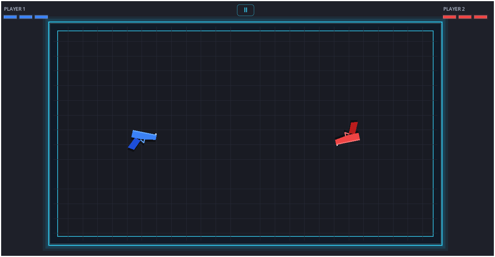

# Recoil Arena

**A local 1v1 arcade duel where every shot moves you.**

Recoil Arena is a physics-driven two-player arcade game built with **Godot 4.7 and GDScript**. There is no movement button: fire to launch a projectile and use its recoil to move, rotate, and line up your next shot. Master your momentum, use the arena walls, and land three hits to eliminate your opponent.

<p align="center">
  
</p>

<p align="center">
  
  
  
  
</p>

## Gameplay

<p align="center">
  
</p>

## Screenshots

<p align="center">
  
  
</p>

## Features

- **Recoil-based movement:** Every shot pushes your gun in the opposite direction. Use that force to move and control your aim.
- **Local two-player matches:** Two players compete on the same screen in one arena.
- **Wall-bouncing projectiles:** Bullets bounce off their first wall and disappear when they hit another.
- **Three-hit rounds:** Take three hits and you are eliminated. The surviving player wins the round.
- **Player collisions:** Guns collide, push apart, and exchange momentum.
- **Mobile touch controls:** Play in landscape orientation, with one side of the screen assigned to each player.
- **Arcade effects and audio:** Muzzle flashes, projectile trails, hit sparks, screen shake, and sound effects add impact to every exchange.
- **Pause and settings:** Pause or resume a match, review the controls, return to the main menu, and adjust master volume.

## Controls

| Action | Player 1 | Player 2 |
| --- | --- | --- |
| Fire (keyboard) | `A` | `L`|
| Fire (mobile) | Tap the left half of the screen | Tap the right half of the screen |
| Pause / resume | `Esc` or the on-screen pause button | `Esc` or the on-screen pause button |

Mobile matches use landscape orientation. Both halves of the screen support simultaneous touches, so both players can fire at the same time.

## How to play

1. Start a match and take control of your side of the arena.
2. Fire to launch a bullet. Recoil pushes your gun in the opposite direction.
3. Rotate and fire to line up shots while avoiding your opponent's projectiles.
4. Use the arena walls to manage your movement and projectile angles. Each bullet can bounce once before disappearing on its next wall contact.
5. Land three hits to eliminate your opponent and win the round.

Your own bullets cannot damage you. There is no movement input; positioning is part of the shooting skill.

## Download and play

You can play Recoil Arena without opening the project in Godot.

1. Visit the [latest GitHub release](https://github.com/iamsaaddar/RecoilArena/releases/latest).
2. Download the build for your device:
   - **Windows:** Download the `.exe` file and open it to launch the game.
   - **Android:** Download the `.apk` file, open it on your device, and follow the installation prompts.
3. Launch Recoil Arena and start a match.

## Run from source

### Requirements

- [Godot Engine 4.7](https://godotengine.org/download/)
- Git (optional, if you are cloning the repository)

### Setup

1. Clone the repository:

   ```bash
   git clone https://github.com/iamsaaddar/RecoilArena.git
   cd RecoilArena
   ```

2. Open Godot's Project Manager and select **Import**.
3. Choose the cloned folder's `project.godot` file and open the project.
4. Press **F5** to run the game from its main scene. Use **F6** to run the currently selected scene in the editor.

The project entry scene is `scenes/main/Main.tscn`. Godot imports the project assets the first time you open it.

## Project structure

<details>
<summary>View project structure</summary>

```text
RecoilArena/
├── assets/
│   ├── audio/                  # Gameplay sound effects
│   ├── Screenshots/            # README screenshots and gameplay GIF
│   ├── icon-crossfire.ico      # Windows application icon
│   └── icon-crossfire.png      # Godot project and Android icon
├── scenes/
│   ├── arena/                  # Arena scene
│   ├── effects/                # Hit and elimination effects
│   ├── main/                   # Main scene and entry point
│   ├── player/                 # Player gun scene
│   └── projectiles/            # Bullet scene
├── scripts/
│   ├── effects/                # Hit effect behavior
│   ├── player/                 # Recoil movement, firing and collisions
│   ├── projectiles/            # Projectile movement and wall bounce
│   └── systems/                # Menus, arena, HUD and match flow
├── .gitignore
├── export_presets.cfg
├── LICENSE
├── project.godot
└── README.md
```

</details>

## Built with

- [Godot Engine 4.7](https://godotengine.org/)
- GDScript
- Godot 2D physics

## License

This project is licensed under the [MIT License](LICENSE).

---

Made by [Saad Dar](https://github.com/iamsaaddar).
