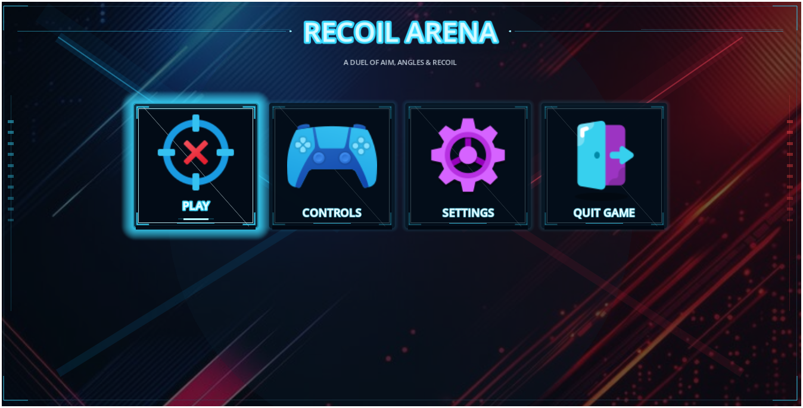
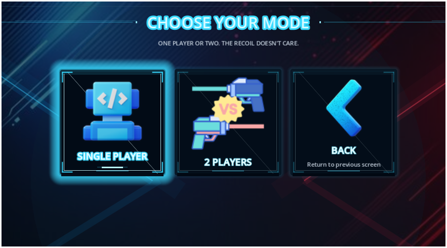
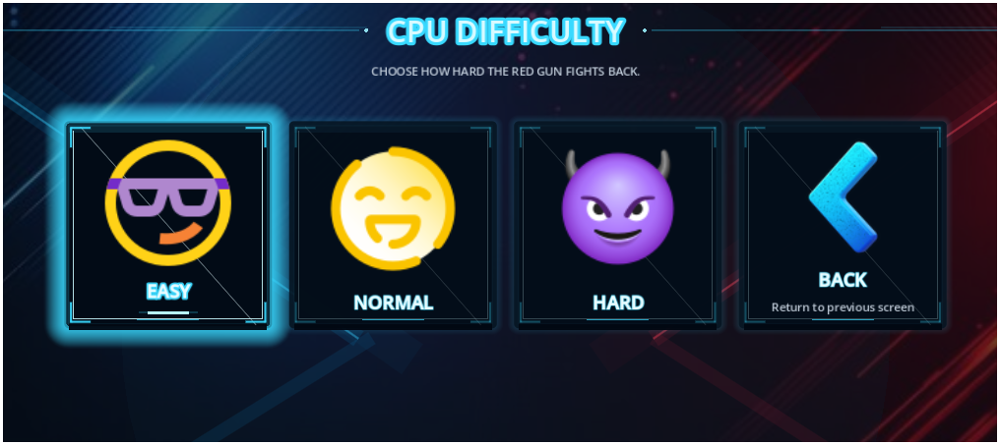
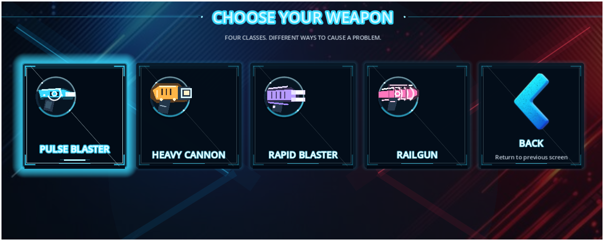
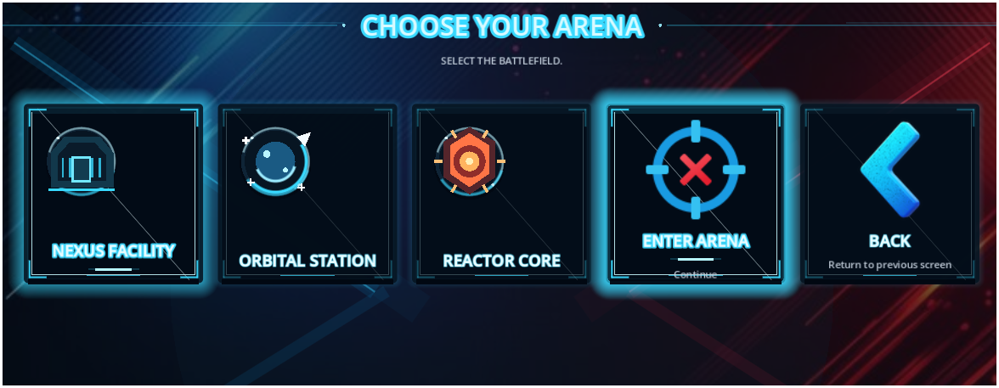

# Recoil Arena

**A physics-driven 2D arcade shooter where every shot moves you.**

Recoil Arena is a fast arena duel built with **Godot 4.7 and GDScript**. Fight a CPU opponent or challenge a friend in local multiplayer. There is no movement button: firing launches a projectile and kicks your gun in the opposite direction. Use recoil, momentum, rotation, and ricochets to control the arena and land the three hits needed to win.

<p align="center">
  
</p>

<p align="center">
  <a href="https://github.com/iamsaaddar/RecoilArena/releases/latest"></a>
  
  
  
  <a href="LICENSE"></a>
</p>

## Contents

- [Gameplay](#gameplay)
- [Screenshots](#screenshots)
- [Features](#features)
- [How to play](#how-to-play)
- [Controls](#controls)
- [Weapons and arenas](#weapons-and-arenas)
- [Download and install](#download-and-install)
- [Technical overview](#technical-overview)
- [Project structure](#project-structure)
- [Run from source](#run-from-source)
- [Export builds](#export-builds)
- [Contributing](#contributing)
- [License](#license)

## Gameplay

<p align="center">
  
</p>

Every shot is also a movement decision. Fire to launch yourself away from the muzzle, use the arena walls to change direction, and try to land three hits before your opponent does.

## Screenshots

The gallery follows the match setup flow, from the main menu to the arena selection screen.

### Main menu

<p align="center">
  
</p>

### Choose a game mode

<p align="center">
  
</p>

### Select CPU difficulty

<p align="center">
  
</p>

### Choose a weapon

<p align="center">
  
</p>

### Choose an arena

<p align="center">
  
</p>

## Features

- **Recoil-driven movement:** Firing pushes your gun backwards. Manage momentum and spin to aim, move, and dodge without a movement button.
- **Single-player mode:** Fight a CPU opponent with Easy, Normal, or Hard difficulty. It aims with configurable reaction delay and accuracy, fires when aligned, and predicts incoming projectiles to dodge.
- **Local multiplayer:** Two players can battle on the same keyboard or mobile device.
- **Three distinct arenas:** Nexus Facility, Orbital Station, and Reactor Core have their own floor details, lighting accents, and visual identity.
- **Four weapon classes:** Pulse Blaster, Heavy Cannon, Rapid Blaster, and Railgun each have different recoil, cooldown, projectile speed, size, and firing behavior.
- **Projectile ricochets:** A projectile can bounce off one arena wall. Its next wall contact destroys it.
- **Three-hit elimination:** Each gun can take three hits. The third hit eliminates it and ends the round.
- **Physical gun collisions:** Opposing guns collide, exchange momentum, and can spin from impact.
- **Combat feedback:** Muzzle flashes, projectile trails, hit bursts, elimination effects, screen shake, and impact audio.
- **Mobile support:** Landscape orientation, responsive arena scaling, and touch controls. Local multiplayer supports simultaneous two-finger input.
- **Menus and settings:** Game mode, CPU difficulty, weapon and arena selection, pause menu, controls screen, and master-volume setting.

## How to play

1. Select **Play** from the main menu.
2. Choose **Single Player** to fight the CPU, or **2 Players** for local multiplayer.
3. In Single Player, choose Easy, Normal, or Hard CPU difficulty.
4. Select a weapon and then an arena.
5. Fire to launch a projectile. Your gun recoils in the opposite direction, so shots are also how you reposition.
6. Manage your momentum, aim while spinning, dodge incoming fire, and use wall ricochets to create attack angles.
7. Land three hits to eliminate your opponent. Choose **Play Again** for another round or return to the main menu.

**Combat rules:** Your own projectiles cannot damage you. Both sides use the weapon selected before the match. A projectile is removed when it hits a gun or makes its second wall contact.

## Controls

### Keyboard

| Action | Player 1 | Player 2 |
| --- | --- | --- |
| Fire | `A` | `L` or `Left Arrow` |
| Pause / resume | `Esc` | `Esc` |

### Mobile

- The game runs in **landscape orientation**.
- **Single Player:** Tap the left half of the screen to fire. The CPU controls the red gun.
- **2 Players:** Tap the left half for Player 1 and the right half for Player 2. Both halves support simultaneous touches.
- Use the on-screen pause control to open the pause menu.

### Weapon-specific input

- **Railgun:** Hold the assigned fire key to charge, then release to fire. On mobile, a tap starts its automatic charge-and-fire cycle.
- **Rapid Blaster:** Hold the assigned fire key to fire repeatedly as its cooldown allows.

## Weapons and arenas

### Weapons

| Weapon | Firing style | Gameplay trade-off |
| --- | --- | --- |
| Pulse Blaster | Standard single shot | Balanced recoil, cooldown, and projectile speed |
| Heavy Cannon | Slow, heavy shot | Strong recoil and a larger projectile |
| Rapid Blaster | Automatic while held | Short cooldown and lighter recoil per shot |
| Railgun | Charge, then release | Long charge, high recoil, and very fast projectile |

### Arenas

| Arena | Visual identity |
| --- | --- |
| Nexus Facility | Cool cyan lighting and a central power coupler |
| Orbital Station | Blue-white station hardware and a central platform |
| Reactor Core | Warm reactor lighting, hazard stripes, and industrial details |

## Download and install

<p align="center">
  <a href="https://github.com/iamsaaddar/RecoilArena/releases/latest"></a>
</p>

Packaged builds are published on the [GitHub Releases page](https://github.com/iamsaaddar/RecoilArena/releases/latest). Godot is not required to play a release build.

| Platform | Download | Install / launch |
| --- | --- | --- |
| Windows 64-bit | `RecoilArena.exe` | Download and run the executable. Game data is embedded in the Windows build. |
| Android | `RecoilArena.apk` | Download and open the APK on your device, then follow Android's installation prompts. You may need to allow installs from your browser or file manager. |

If a platform's build is not attached to the latest release yet, check the release assets or the project's [Releases page](https://github.com/iamsaaddar/RecoilArena/releases).

## Technical overview

Recoil Arena is implemented as a small set of cooperating Godot scenes and GDScript systems. The main scene owns the menu and active match; the arena creates and connects the combat entities and match UI.

### Runtime architecture

```text
Main.tscn / Main.gd
  ├── Menu, setup flow, pause and settings
  └── Arena.tscn / Arena.gd
       ├── Gun.gd (Player 1 and Player 2 / CPU)
       │    ├── Recoil, rotation and gun collision
       │    └── WeaponCatalog.gd
       ├── CPUController.gd (single-player mode)
       ├── Bullet.gd (projectile movement and wall bounce)
       ├── HealthHUD.gd (hearts, winner and replay flow)
       └── HitSpark.gd (hit and elimination effects)
```

This is a responsibility map, not a strict node-for-node scene tree. The arena instantiates the guns, projectile container, HUD, camera, and optional CPU controller at runtime.

### Core systems

| System | Implementation | Responsibility |
| --- | --- | --- |
| Game flow | `scripts/systems/Main.gd` | Main menu, mode and loadout selection, pause flow, settings, and arena lifetime |
| Arena and match | `scripts/systems/Arena.gd` | Spawning, input routing, projectile ownership, hit handling, round transitions, camera scaling, and audio/effects coordination |
| Gun physics | `scripts/player/Gun.gd` | Recoil impulses, angular motion, aiming, arena bounds, opponent collision, damage, and weapon input |
| CPU opponent | `scripts/ai/CPUController.gd` | Difficulty presets, imperfect target tracking, firing decisions, and projectile-threat dodging |
| Weapons | `scripts/systems/WeaponCatalog.gd` | Shared weapon identifiers and combat tuning values |
| Projectiles | `scripts/projectiles/Bullet.gd` | Projectile movement, shooter collision exclusion, trail rendering, hit detection, and one-wall-bounce lifetime |
| Health and results | `scripts/systems/HealthHUD.gd` | Side-mounted heart indicators, hit animation, winner display, countdown, and replay controls |
| Combat effects | `scripts/effects/HitSpark.gd` | Particle bursts, impact rings, and elimination shards |

### Physics and gameplay model

- Guns use `RigidBody2D` nodes for collision participation, while their recoil-driven movement, rotation, and arena-boundary response are updated in the gun controller.
- Firing applies an impulse opposite the shot direction and adds angular motion. Weapon values are read from the shared weapon catalog.
- Projectiles use `CharacterBody2D` movement with collision checks. The first wall contact reflects velocity; the next wall contact removes the projectile.
- The CPU uses reaction and fire timers, angular aim error, and relative-motion prediction to choose shots and dodge threats. It sends commands through the same gun firing and recoil path as a human player.
- The arena coordinates hit counting, three-hit elimination, round locking, replay countdown, and CPU reset.
- The project uses Godot's **GL Compatibility** renderer for desktop and mobile.

### Technology

- [Godot Engine 4.7](https://godotengine.org/)
- GDScript
- Godot 2D nodes, collision shapes, and physics-related movement
- Layered 2D drawing for the game's 2D visual presentation
- Windows Desktop and Android export presets
- Git and GitHub for source control and releases

## Project structure

```text
RecoilArena/
├── assets/
│   ├── audio/                   # Gunfire, impacts, ricochets and elimination sounds
│   ├── Screenshots/             # README screenshots and gameplay GIF
│   ├── textures/icons/          # Menu background and selection artwork
│   ├── icon-crossfire.ico       # Windows application icon
│   └── icon-crossfire.png       # Godot and Android application icon
├── scenes/
│   ├── arena/                   # Arena scene and environment resources
│   ├── effects/                 # Hit and elimination effect scene
│   ├── main/                    # Main entry scene
│   ├── player/                  # Gun scene
│   └── projectiles/             # Projectile scene
├── scripts/
│   ├── ai/                      # CPU opponent controller
│   ├── effects/                 # Combat effect behavior
│   ├── player/                  # Gun behavior and recoil physics
│   ├── projectiles/             # Projectile movement and collision
│   └── systems/                 # Main flow, arena, HUD and weapon catalog
├── export_presets.cfg           # Windows Desktop and Android presets
├── project.godot                # Godot project settings and main scene
├── LICENSE                      # MIT license
└── README.md
```

## Run from source

### Requirements

- [Godot Engine 4.7](https://godotengine.org/download/)
- Git (optional, if you want to clone the repository)

### Setup

1. Clone the repository:

   ```bash
   git clone https://github.com/iamsaaddar/RecoilArena.git
   cd RecoilArena
   ```

2. Open **Godot Project Manager** and choose **Import**.
3. Select the repository's `project.godot` file.
4. Open the project and allow Godot to import the assets.
5. Press **F5** to run the project.

The main entry scene is `scenes/main/Main.tscn`. To run an individual scene for testing, open it in the editor and press **F6**.

## Export builds

The repository includes two presets in `export_presets.cfg`:

| Preset | Configuration |
| --- | --- |
| Windows Desktop | 64-bit Windows executable with the project data embedded in the `.exe` |
| Android | APK export configured for `arm64-v8a` |

To export:

1. Install the matching export templates from the Godot version used by the project.
2. Open **Project → Export** in Godot.
3. Select **Windows Desktop** or **Android**.
4. Install any platform-specific build tools Godot requests. Android exports require a configured Android SDK and Java/JDK.
5. Choose an output path and export the project.

The preset output paths default to `RecoilArena.exe` and `RecoilArena.apk` in the project directory. Keep signing keys and other private release credentials out of the repository.

## Contributing

Bug reports, gameplay feedback, and focused pull requests are welcome. Before proposing a change:

1. Reproduce the issue or describe the gameplay behavior you want to improve.
2. Keep changes focused and preserve the existing input, physics, and mobile behavior unless the change specifically targets them.
3. Test the affected mode on desktop. Test Android touch behavior too when changing input, layout, or scaling.
4. Include clear reproduction steps and screenshots or a short recording for visual changes where useful.

## License

Recoil Arena is released under the [MIT License](LICENSE).

---

Made by [Saad Dar](https://github.com/iamsaaddar).
